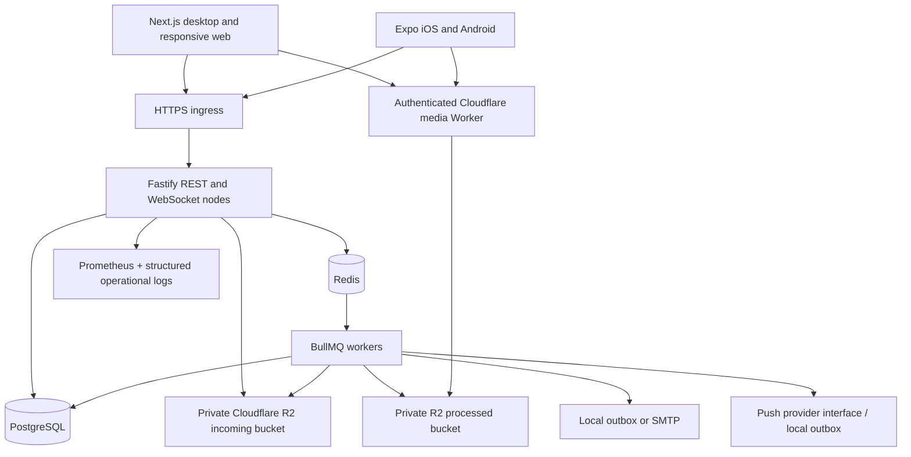

# Architecture

ProductScroll is a modular monolith with independently running web, mobile, API and worker processes. PostgreSQL is the source of truth. Redis holds bounded ranking snapshots, caches, rate limits, OAuth state, one-use socket tickets, job state and realtime fanout. Losing a socket does not lose messages; clients reload history from PostgreSQL.

## Boundaries

| Package                  | Responsibility                                                                                          |
| ------------------------ | ------------------------------------------------------------------------------------------------------- |
| `apps/web`               | Accessible, responsive consumer UI; three-column desktop layout and five-tab phone navigation           |
| `apps/mobile`            | Native navigation, SecureStore sessions, FlatList feed, expo-video playback, mobile uploads             |
| `apps/api`               | Transport validation, authentication, domain authorization, transactions, DTO presentation, jobs        |
| `apps/worker`            | Media validation/transcoding, email and notification delivery, event ingestion, cleanup, reconciliation |
| `packages/database`      | Prisma schema/client, migrations, seed, query timing observer                                           |
| `packages/types`         | Shared public DTO contracts; no password, email or session columns in public user DTOs                  |
| `packages/validation`    | Shared identifier/pagination/event schemas                                                              |
| `packages/api-client`    | Consistent typed response decoding and API errors                                                       |
| `packages/analytics`     | Engagement event vocabulary                                                                             |
| `packages/design-tokens` | Shared colors, spacing/radii and web CSS variables                                                      |
| `packages/config`        | Upload limits and validated Cloudflare R2 configuration                                                                                  |

API domains separate identity, social graph, startup/product ownership, content/feed, messaging, media and moderation. All consumers use the same server; Next.js route handlers do not duplicate business rules. `features/investment` is a disabled boundary with no transactions, money handling or finance columns.

## Data flows

**Publish:** client requests upload authorization → writes to private incoming storage → marks complete → queues job → worker inspects actual bytes and dimensions → transcodes HLS variants / WebP → sets media READY → publication validates ownership and READY status → transaction persists post/media links → queues follower notifications.

**Message:** REST checks membership, acceptance and block relationships → transaction persists message and sender read → Redis publishes to recipients → socket gateway delivers → recipient REST marks read → Redis sends read event. Reconnection obtains a new one-use ticket and reloads history. WebSockets transport events, not durable state.

**Feed:** bounded candidate queries → behavioral affinities → configurable scoring/diversity → Redis snapshot of IDs → keyset/snapshot paging → batch DTO query. Visibility is rechecked when each page is fetched.

## Provider seams and operational limits

Storage selects local development or Cloudflare R2 via `MEDIA_DRIVER`; email has local/SMTP implementations; push has an explicit interface with a local implementation. Transcoding is isolated in `processMedia`. Error reporting uses a replaceable `ErrorReporter` receiving sanitized error class, route template and request ID. Installing a hosted monitoring SDK belongs in this adapter.

Search uses PostgreSQL parameterized full-text/trigram queries within the startup domain. Extract that search implementation into a dedicated service before adding a remote search engine; callers already consume one REST result shape.

The current database and Redis commit together only at application level, not in one transaction. A worker retry is idempotent for event insertion and deterministic notification IDs, but a process crash between a database commit and enqueue can miss a notification. A transactional outbox is a prerequisite for stronger delivery guarantees. Horizontal API nodes coordinate live delivery through Redis; local media requires a shared volume, while R2 separates media storage from nodes.

This code is a working application, not a claim of completed production certification. Device profiling, live R2/Worker verification, fault-injection, external providers and full browser CI are explicit release gates in VALIDATION.md.

## Scale controls

Public discovery IDs are cached for 15 seconds; each request reapplies personalized visibility. Candidate and history reads are bounded, and Reels ranks only the next ten winners. PostgreSQL maintains startup follower counters with an insert/delete trigger. Each process defaults to five database connections; deployments must budget the sum across replicas.

BullMQ separates default delivery, CPU-heavy media, analytics events and paged notification fanout. Worker replicas select queue groups through `WORKER_QUEUES`. Fanout handles 250 followers per job; cleanup handles 500 rows per job. Redis realtime channels are scoped to connected users, with slow-socket disconnection and ping/pong liveness checks.

R2 uploads and downloads stream through bounded worker memory. Clients upload directly to private R2 incoming storage. A Cloudflare Worker verifies an asset-scoped, 15-minute signature before its internal cache lookup and propagates that signature through HLS manifests. The API checks current visibility when issuing/refreshing playback links. This is bearer-capability access: an already issued link can work until expiry. See R2_SETUP.md and SCALABILITY_REVIEW.md.
