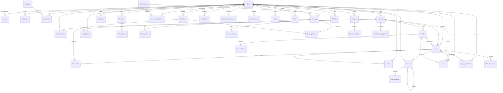

# Database

The authoritative schema is [schema.prisma](packages/database/prisma/schema.prisma). Six versioned SQL migrations create the schema, full-text/trigram and feed indexes, integrity checks, a maintained startup follower counter, and recent-follow retrieval indexes. `pnpm db:migrate` runs `prisma migrate deploy`; it does not reset data.

## Main relationships



Standalone operational records are `FeatureFlag`, `RankingConfig` and `JobFailure`. The complete field definitions, referential actions and indexes remain in Prisma and SQL; this diagram illustrates relationships without replacing the schema.

## Integrity

Unique constraints prevent duplicate usernames/emails/slugs, follows, likes, saves, conversation memberships and collection items. Saves use nullable polymorphic targets with a SQL check requiring exactly one post/startup/product. SQL also rejects self-follow/self-block, negative denormalized counters and invalid file size. Team membership assigns OWNER, ADMIN, CONTENT_MANAGER or ANALYST independently of the platform role.

Engagement joins are canonical; post counters are maintained inside the same transaction as like/save/comment changes and can be reconciled by an opt-in maintenance worker. Startup follower counts use a database trigger so duplicate follows and cascading deletes remain consistent. Message receipts are per user. Posts support draft and removal timestamps; a draft is not a feed candidate. Media publication is gated by READY and owner identity.

Feed/message/comment cursors include deterministic createdAt/id ordering. Full-text GIN and trigram indexes support ranked search without unrestricted wildcard scans. Main access paths include startup/user posts, follows, conversations, pending media and notification timelines. Run `EXPLAIN (ANALYZE, BUFFERS)` against production-shaped data before changing candidate limits or claiming scale targets.

## Development and migrations

```sh
pnpm db:generate
pnpm db:validate
pnpm db:migrate
pnpm db:seed
# Only when authoring a new reviewed schema change:
pnpm --filter @productscroll/database exec dotenv -e ../../.env -- prisma migrate dev --name descriptive_change
```

Never edit an already deployed migration. Create additive migrations first, deploy code compatible with old/new shapes, backfill in bounded batches, then remove old columns in a later release. Set a lock timeout when doing index changes; create large indexes concurrently through a separately reviewed migration outside a transaction where required.

The seed is repeatable and uses stable IDs for fictional users/startups/posts. It intentionally restores known demo passwords and demo profile values; do not run it on a live user database.

## Recovery

`scripts/backup.sh` creates a custom PostgreSQL archive and verifies the archive listing. Use a pg_dump version at least as new as the server. `scripts/restore.sh` refuses a nonempty target and restores into an explicitly supplied new database. Archive verification is not a restore drill. See DEPLOYMENT.md for object storage backup, PITR, encryption, retention and rehearsal requirements.
